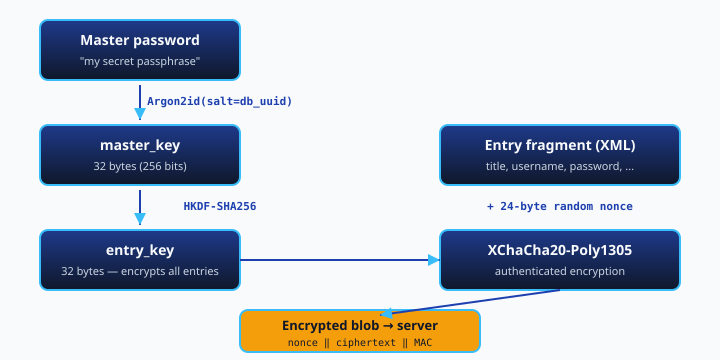
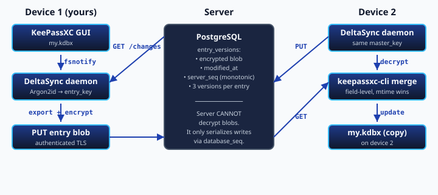
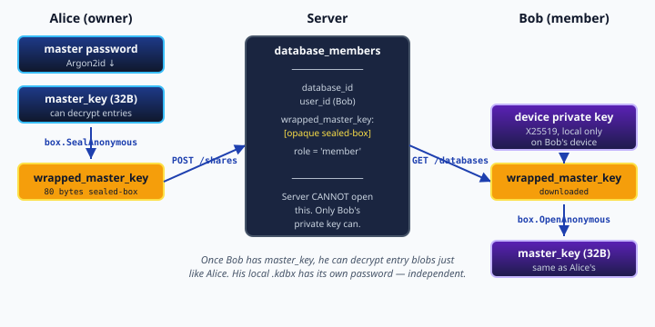

# DeltaSync

End-to-end encrypted, entry-level synchronization for KeePass databases (`.kdbx`). Concurrent edits from multiple devices are merged per entry with KeePassXC's own merge engine, so nothing is lost and no "conflicted copy" files appear.

The file format (`.kdbx`) is unchanged — you keep using KeePassXC, KeePassDX or Keepass2Android as before. Sync happens through a small server you host yourself, which only ever sees client-encrypted blobs; your master password never leaves your device.

- **Website:** [deltasync.org](https://deltasync.org/) — introduction, diagrams, getting started and FAQ.
- **Documentation:** [project wiki](https://gitlab.com/Star95/keepass-deltasync/-/wikis/home) — running your own server, architecture, and troubleshooting.
- **Server:** Docker image (amd64 + arm64), the [TrueNAS community app](https://apps.truenas.com/catalog/), or plain PHP hosting — see [Getting started](#getting-started).
- **Desktop (Windows, macOS, Linux):** client and GUI from [Releases](https://gitlab.com/Star95/keepass-deltasync/-/releases); Windows gets both in one `setup.exe`.
- **Android:** [Google Play](https://play.google.com/store/apps/details?id=dk.bjoerckbraun.deltasync), [F-Droid](https://f-droid.org/packages/dk.bjoerckbraun.deltasync/), or the APK from [GitHub releases](https://github.com/HBBSoftware/Keepass-DeltaSync/releases).
- **Browser search extension (optional):** [Firefox](https://addons.mozilla.org/firefox/addon/deltasync-keepass-search-go/) and [Edge](https://microsoftedge.microsoft.com/addons/detail/dpmaneajjlanhipmbgdpdnfljiigdnjo); Chrome from source for now.
- **Deep dive:** [`docs/`](docs/) — threat model, concurrent-write semantics, deployment recipes. Full specification in [`keepass-deltasync-spec.md`](keepass-deltasync-spec.md).

## Repository layout

This monorepo contains six components, each with its own license:

| Directory | Component | License | Language |
|-----------|-----------|---------|----------|
| [`server/`](server/) | Sync server | AGPL-3.0-or-later | PHP 8.2 + PostgreSQL |
| [`client/`](client/) | Desktop sync agent | GPL-3.0-or-later | Go |
| [`gui/`](gui/) | Desktop GUI — wraps the client | GPL-3.0-or-later | Go + Fyne |
| [`android/`](android/) | Android client | GPL-3.0-or-later | Go (gomobile) + Kotlin |
| [`extension/`](extension/) | Firefox extension — search & go | GPL-3.0-or-later | JavaScript (WebExtension) |
| [`extension-chromium/`](extension-chromium/) | Chrome/Edge extension — the same, built from `extension/` | GPL-3.0-or-later | JavaScript (WebExtension) |
| [`docs/`](docs/) | Shared documentation | CC-BY-SA-4.0 | Markdown |

Client and server only communicate over a well-defined HTTP API, so GPL/AGPL does not bleed across the boundary.

## Status

**All components are released and in active use**: server, desktop client and GUI, Android app, and the browser extension. Per-release changes are in [`CHANGELOG.md`](CHANGELOG.md).

- **Server** (PHP / PostgreSQL): runs in Docker, as a TrueNAS app, or on shared PHP hosting. Endpoints for enrollment, entries with 3-version history, restore, multi-user sharing, admin CLI, web admin panel, audit log.
- **Desktop client** (Go): `enroll`, `init`, `init-shared`, `push`, `pull`, `sync`, `daemon` (fsnotify + polling), `versions`, `restore`, `share` / `unshare` / `shares`. Crypto: Argon2id → HKDF → XChaCha20-Poly1305 for entries; X25519 sealed-box for sharing. v3 canonical wire-format with dual-read of v1 legacy blobs during migration.
- **Desktop GUI** (Go / Fyne): onboarding wizard (enroll device → add database) plus a dashboard for syncing, autostart, admin and log. It owns no crypto, server or config logic — it shells out to the `keepass-deltasync` binary, exactly like the CLI's own `tui`. Windows users get GUI and CLI in one `setup.exe` from [`gui/installer/`](gui/installer/). See [`gui/README.md`](gui/README.md).
- **Firefox extension**: search your entries from the address bar or a popup and open the entry's site; credential filling stays with KeePassXC-Browser. Talks to `keepass-deltasync browser-host` over native messaging and only ever receives titles, URLs and group paths — never secrets. Runs without a server: `add-local` registers a `.kdbx` for search only, so the extension is usable on its own. Published on [addons.mozilla.org](https://addons.mozilla.org/firefox/addon/deltasync-keepass-search-go/) and [Edge Add-ons](https://microsoftedge.microsoft.com/addons/detail/dpmaneajjlanhipmbgdpdnfljiigdnjo) — see [`docs/install-browser.md`](docs/install-browser.md) for setup and [`extension/README.md`](extension/README.md) for the design. The Chrome/Edge build comes from the same sources — see [`extension-chromium/README.md`](extension-chromium/README.md).
- **Android app**: keeps a `.kdbx` in sync in the background, while you edit it in KeePassDX or Keepass2Android. Available on Google Play and F-Droid, all channels signed with the same key. See [`android/README.md`](android/README.md). Built on top of `client/mobile/` via `gomobile bind` + kotpass.

## How it works

### Crypto stack

The client derives an entry encryption key from your master password and encrypts each entry locally. The server only ever stores the opaque blob.



- **Argon2id** raises the cost of brute-forcing the master password (~200 ms, 64 MiB RAM per attempt).
- **HKDF-SHA256** gives a clean, deterministic separation between the master key and per-use-case subkeys.
- **XChaCha20-Poly1305** provides authenticated encryption — the server cannot tamper with blobs undetected.
- **24-byte random nonces** make nonce reuse practically impossible.

### Bidirectional sync

The daemon reacts to two triggers: *fsnotify* (you saved in KeePassXC) and *polling* (changes from other devices). Merges happen on the client via `keepassxc-cli`, field-level, last-writer-wins on `LastModificationTime`.



Both devices derive the same `master_key` from the same master password. The server only serializes writes via a monotonic `database_seq`; it cannot decrypt anything.

### Multi-user sharing

To share a database with another user, the owner wraps `master_key` with the recipient's device public key using NaCl's anonymous sealed-box. The server stores the opaque wrap but cannot open it.



Once Bob has `master_key`, he can decrypt entries just like Alice. His local `.kdbx` has its own password, independent of Alice's. See [`docs/v2-concurrent-write-semantics.md`](docs/v2-concurrent-write-semantics.md) for how concurrent edits are handled.

## Getting started

### As an administrator (server side)

**Run your own server with Docker (easiest).** A prebuilt, multi-arch image (amd64 + arm64) is published to the GitLab Container Registry, and [`compose.yml`](compose.yml) brings up a self-contained stack (PostgreSQL + app). It works on any Docker host or a NAS such as TrueNAS SCALE / Unraid / Synology — paste the YAML, set one password, start:

```sh
# edit the single CHANGE_THIS password line in compose.yml, then:
docker compose up -d
docker compose logs app                          # copy the one-time admin token
docker compose exec app php bin/admin user:create alice
```

Image: `registry.gitlab.com/star95/keepass-deltasync/server:latest`. Schema migrations run automatically on start. Full walkthrough — including TrueNAS, HTTPS and backups — in [`docs/self-hosting-docker.md`](docs/self-hosting-docker.md). The same image is also published as `ghcr.io/hbbsoftware/deltasync-server` and on Docker Hub as `hbbsoftware/deltasync-server`.

**TrueNAS SCALE.** DeltaSync is in the official [TrueNAS apps catalog](https://apps.truenas.com/catalog/) (community train) — search for "KeePass DeltaSync" under Apps and install it from there.

**Web admin panel.** Browse to `https://your-server/admin.html`, paste your admin token, and manage the server from the browser — create users, issue enrollment tokens, enable/disable/delete users, and view the audit log. (The CLI `bin/admin` does the same and is handy for first-user bootstrap.)

**Classic PHP hosting (no Docker).** The server is plain PHP with no build step; upload it and run the setup wizard. See [`server/README.md`](server/README.md) and [`docs/deployment.md`](docs/deployment.md). Schema lives in [`server/schema/`](server/schema/).

### As a first-time user (client side)

**Option A — download a pre-built binary** from [Releases](https://gitlab.com/Star95/keepass-deltasync/-/releases): pick your OS, extract, run. No Go toolchain.

**Option B — build from source** (requires Go 1.22+):

```sh
cd client && go build -o keepass-deltasync ./cmd/keepass-deltasync
```

Then (either option):

```sh
# Your administrator gave you an enrollment token
./keepass-deltasync enroll --server https://your-server.example.com <token>

# Register a local .kdbx
./keepass-deltasync init mypasswords ~/keepass/my.kdbx

# Sync once
./keepass-deltasync sync mypasswords

# Let the daemon sync automatically (fsnotify + polling)
./keepass-deltasync daemon --store-keyring
```

### As the recipient of a shared database (v2)

```sh
# Alice has shared her database with you. It shows up in your list:
./keepass-deltasync databases
# passwords  ...  role=member

# Bootstrap a local copy:
./keepass-deltasync init-shared passwords ~/keepass/shared.kdbx
# Prompt: pick a new local password for your copy
```

After that, sharing is transparent — `sync` / `daemon` behave the same as for owned databases.

### As the owner sharing a database (v2)

```sh
# Share with another user (they must be enrolled and have used the client at least once)
./keepass-deltasync share passwords bob

# List members
./keepass-deltasync shares passwords

# Remove a member (or leave a database you don't own)
./keepass-deltasync unshare passwords bob
```

## Trust model in brief

- **The server sees:** encrypted entry blobs, mtimes, deletions, user and device metadata, an audit log with IP and user-agent.
- **The server does not see:** entry content (titles, usernames, passwords), master passwords, or database master keys.
- **Multi-user sharing:** when Alice shares with Bob, the database `master_key` is sealed-box-encrypted to Bob's device public key. The server only sees the opaque sealed-box blob; only Bob's device private key can unwrap it.

See [`docs/threat-model.md`](docs/threat-model.md) for the full trust model.

## Contributing

DeltaSync is maintained by one person. Issues and merge requests are welcome on [GitLab](https://gitlab.com/Star95/keepass-deltasync); see [`CONTRIBUTING.md`](CONTRIBUTING.md).

- Please sign off contributed commits (DCO, `git commit -s`).
- Security issues go through a private channel, not public issues — see [`SECURITY.md`](SECURITY.md).
- Crypto and auth code gets the most scrutiny: changes there need tests, and an independent review of that code is especially welcome.
